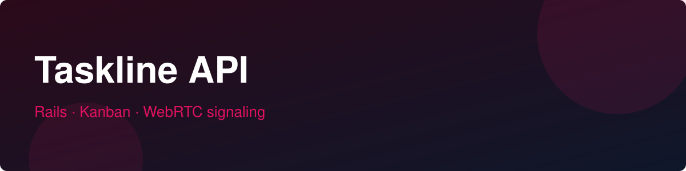

# Taskline API

[](https://github.com/plucasr/taskline-api/actions/workflows/ci.yml) [](LICENSE)

Rails API for **Taskline** — kanban boards with minimal room chat and
WebRTC voice (P2P via WebSocket signaling).

## Features
- Kanban: boards, columns, cards, members with owner/member roles
- JWT auth (`POST /api/v1/signup`, `POST /api/v1/login`)
- Cards move across columns with position ordering
- Clients: [taskline-web](https://github.com/plucasr/taskline-web) · [taskline-mobile](https://github.com/plucasr/taskline-mobile)

## Stack
Ruby on Rails 8 (API-only) · PostgreSQL · JWT

## Development (Docker only, no local Ruby needed)

```bash
docker compose up db        # start Postgres
docker compose build api    # first run only: installs gems into the image
docker compose up api       # server on http://localhost:3000
```

Everyday tasks:

```bash
docker compose run --rm api bin/rails console
docker compose run --rm api bin/rails db:migrate
docker compose run --rm -e RAILS_ENV=test \
  -e DATABASE_URL=postgres://postgres:postgres@db:5432/taskline_test \
  api bin/rails test
```

## Error format

| Status | Shape | When |
|---|---|---|
| 400 | `{ "error": "..." }` | malformed request |
| 401 | `{ "error": "..." }` | missing/invalid token |
| 403 | `{ "error": "..." }` | authenticated but not allowed |
| 404 | `{ "error": "Not found" }` | missing or unauthorized record |
| 422 | `{ "errors": ["...", "..."] }` | validation failures |

## Status
Actively built over 60 days — see [TODO.md](TODO.md) for the traceable plan.
